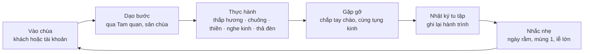
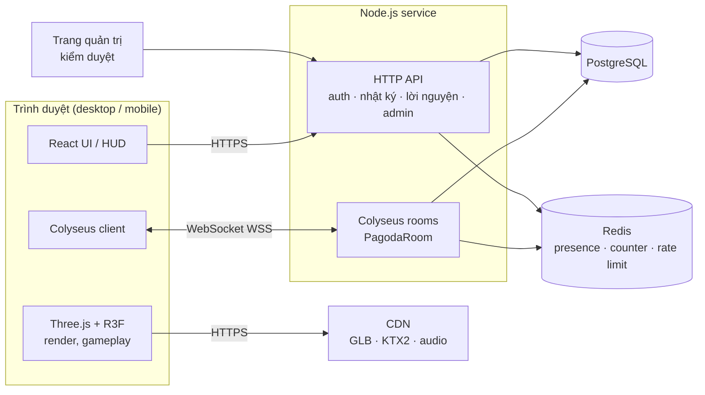
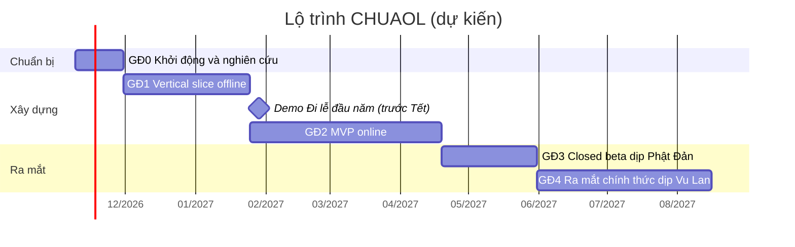

# Kế hoạch phát triển CHUAOL — Chùa Online 3D trên nền tảng Three.js

> Phiên bản: 0.1 (bản nháp đầu tiên) · Ngày lập: 03/11/2026
> Phạm vi: tầm nhìn sản phẩm, thiết kế trải nghiệm, kiến trúc kỹ thuật, lộ trình, đội ngũ, rủi ro, pháp lý.

---

## 0. Tóm tắt

**CHUAOL** là một không gian chùa Việt 3D chạy ngay trên trình duyệt (desktop và điện thoại), xây bằng **Three.js**. Người chơi có thể dạo bước qua Tam quan, thắp hương, thỉnh chuông, gõ mõ, ngồi thiền, nghe kinh, thả đèn hoa đăng, và **gặp những người khác cùng đi lễ theo thời gian thực**.

| Hạng mục | Lựa chọn khuyến nghị |
|---|---|
| Client 3D | Three.js qua **React Three Fiber** + drei, TypeScript, Vite |
| Vật lý / di chuyển | Rapier (`@react-three/rapier`) + character controller |
| Multiplayer | **Colyseus** (Node.js, phòng 50 người, đồng bộ bằng WebSocket) |
| Backend / dữ liệu | Node.js + PostgreSQL (Prisma) + Redis |
| Asset | Blender → glTF/GLB, nén Meshopt/Draco + texture KTX2 |
| Hạ tầng | Client tĩnh + CDN; game server đặt ở VN hoặc Singapore |
| Lộ trình | ~9 tháng: demo Tết 2027 → closed beta dịp Phật Đản → ra mắt dịp Vu Lan 2027 |

Ba nguyên tắc không thay đổi: **tôn kính**, **thanh tịnh**, **không thương mại hóa tâm linh** (không bán "phước", không xếp hạng công đức theo tiền).

---

## 1. Tầm nhìn và nguyên tắc

### 1.1 Tầm nhìn
Tạo một nơi để người Việt — ở trong nước hay ở nước ngoài — có thể "đi chùa" bất cứ lúc nào: tĩnh tâm vài phút sau giờ làm, cùng gia đình ở xa đi lễ đầu năm, hoặc để người trẻ tìm hiểu kiến trúc và nghi lễ chùa Việt.

### 1.2 Đối tượng người chơi
| Nhóm | Nhu cầu chính |
|---|---|
| Người đi làm 25–45 tuổi | Tĩnh tâm ngắn (5–15 phút), thiền, nghe kinh |
| Người Việt ở nước ngoài | Đi lễ ngày rằm, mùng 1, Tết; đi chùa cùng người thân ở Việt Nam |
| Người lớn tuổi (qua con cháu) | Trải nghiệm đơn giản, chữ to, ít thao tác |
| Học sinh, sinh viên | Tìm hiểu văn hóa, kiến trúc, nghi lễ |

### 1.3 Nguyên tắc thiết kế
1. **Tôn kính** — Chính điện là khu vực trang nghiêm: không chạy, không nhảy, không emote vui nhộn, không thể leo lên bàn thờ hay tượng. Nội dung nghi lễ và giáo lý do cố vấn Phật giáo duyệt.
2. **Thanh tịnh** — Nhịp chậm, âm thanh là trung tâm, giao diện tối giản, không thông báo dồn dập, không đồng hồ đếm ngược gây áp lực.
3. **Không thương mại hóa tâm linh** — Mọi hoạt động tâm linh cốt lõi đều miễn phí. Không gacha, không bán "lộc" hay "may mắn", không bảng xếp hạng công đức.
4. **Mở là vào được** — Không cài đặt; có thể vào ngay. Phải chạy được trên điện thoại Android tầm trung.
5. **Cộng đồng tử tế** — Mặc định an toàn: giai đoạn đầu chỉ dùng câu chào mẫu; lời nguyện để riêng tư, chỉ công khai khi người dùng chọn và đã qua kiểm duyệt.

### 1.4 Giả định của bản kế hoạch
- Đội lõi 5–6 người toàn thời gian, cộng thêm cộng tác viên âm thanh và cố vấn văn hóa (xem mục 6).
- Ngôi chùa trong game là **chùa nguyên bản**, lấy cảm hứng từ kiến trúc chùa Bắc Bộ (bố cục chữ Đinh/chữ Công). Số hóa chùa thật chỉ làm sau khi có hợp tác chính thức.
- Ngôn ngữ chính là tiếng Việt, tiếng Anh bổ sung sau khi ra mắt.

---

## 2. Thiết kế trải nghiệm

### 2.1 Vòng lặp chính



Thời lượng một phiên mục tiêu: **5–15 phút**. Không có "thua", không có áp lực.

### 2.2 Bản đồ chùa

| Khu vực | Mô tả | Hoạt động | Giai đoạn |
|---|---|---|---|
| Tam quan | Cổng ba lối, điểm bắt đầu, có biển giới thiệu | Chụp ảnh, đọc giới thiệu | MVP |
| Sân chùa | Sân lát gạch, cây bồ đề, lư hương lớn | Thắp hương, gặp gỡ | MVP |
| Gác chuông | Chuông đồng lớn | Thỉnh chuông (cả phòng cùng nghe) | MVP |
| Tiền đường và Chính điện | Khu thờ Phật, trang nghiêm | Lễ Phật, gõ mõ, tụng kinh chung | MVP |
| Hồ sen | Mặt nước, sen, cầu đá | Thả đèn hoa đăng | MVP |
| Thiền đường / góc thiền | Chỗ yên tĩnh dưới tán cây | Thiền có hướng dẫn hơi thở | MVP |
| Nhà Tổ | Thờ các vị Tổ | Tìm hiểu lịch sử | Sau MVP |
| Vườn tháp | Tháp mộ cổ, rừng trúc | Dạo bộ, nghe pháp thoại | Sau MVP |
| Pháp đường | Không gian giảng pháp | Nghe pháp thoại, sự kiện trực tiếp | Sau MVP |

Người chơi đi theo trục chính: Tam quan → sân chùa → Tiền đường → Chính điện, Nhà Tổ nằm phía sau. Mỗi khu là một "zone" tải riêng để tải dần (xem 4.4).

### 2.3 Hoạt động và tương tác

| Hoạt động | Cách chơi | Yếu tố chung với người khác | Giai đoạn |
|---|---|---|---|
| Thắp hương | Lấy hương → châm lửa → chắp tay khấn (có thể gõ lời nguyện riêng) → cắm vào bát hương | Nén hương hiện cho cả phòng, cháy dần, khói bay; bộ đếm "Hôm nay có N nén hương" | MVP |
| Thỉnh chuông | Đến gác chuông, kéo thanh gỗ theo nhịp | Tiếng chuông vang cho cả phòng (âm thanh 3D); có thời gian chờ để tránh spam | MVP |
| Gõ mõ, tụng kinh | Gõ mõ theo nhịp, hiển thị phụ đề lời kinh | Khóa tụng kinh chung theo giờ, đồng bộ âm thanh theo giờ server | MVP |
| Lễ Phật | Emote: chắp tay, cúi đầu, lạy | Người khác nhìn thấy động tác | MVP |
| Thiền | Ngồi vào bồ đoàn → camera chuyển chế độ cảnh quay → vòng tròn hướng dẫn hít thở, hẹn giờ 3/5/10/20 phút | Thấy người khác đang ngồi thiền gần đó | MVP |
| Thả đèn hoa đăng | Viết lời tri ân/cầu nguyện → thả đèn xuống hồ | Đèn trôi trên hồ mà mọi người cùng thấy trong ~3 phút | MVP |
| Nghe kinh, pháp thoại | Trình phát audio trong Pháp đường | Nghe chung theo lịch | Sau MVP |
| Đi lễ cùng nhau | Tạo phòng riêng bằng mã mời cho gia đình, bạn bè | Đi cùng nhau, cùng thắp hương | MVP+ (ngay sau MVP) |
| Góc tìm hiểu | Đến gần một kiến trúc → hiện biển giải thích ngắn | — | MVP |

**Hướng dẫn nghi lễ nhẹ nhàng**: lần đầu làm mỗi hoạt động sẽ có một gợi ý ngắn về ý nghĩa và cách làm. Toàn bộ nội dung do cố vấn duyệt, tránh khẳng định sai lệch.

### 2.4 Xã hội và multiplayer
- Mỗi phòng (một "sân chùa") có tối đa **50 người**. Khi đầy, hệ thống tự mở phòng mới; người chơi có thể chọn phòng của bạn bè.
- Giao tiếp ở MVP: **emote** và **câu mẫu** ("A Di Đà Phật", "Chúc an lành", "Cảm ơn", "Mời bạn cùng thiền"...). Chat tự do chỉ mở sau khi bộ lọc và quy trình kiểm duyệt đã chạy ổn.
- Có thể chặn hoặc ẩn người khác, và báo cáo vi phạm.
- Có "khoảng cách tôn trọng": avatar khác mờ dần khi đứng quá sát để tránh quấy rối.

### 2.5 Lịch âm và sự kiện
- Tính âm lịch Việt Nam bằng thuật toán của Hồ Ngọc Đức, chạy ở server; client nhận về ngày âm hiện tại.
- Chu kỳ ngày/đêm đồng bộ với giờ Việt Nam (Asia/Ho_Chi_Minh): chuông sớm, đèn lồng sáng khi tối, có thời khóa tụng kinh sáng và chiều.
- Sự kiện định kỳ: **mùng 1, rằm** hằng tháng (trang trí, khóa tụng chung).
- Sự kiện lớn trong năm:

| Sự kiện | Nội dung trong game |
|---|---|
| Tết Nguyên Đán, Rằm tháng Giêng | Đi lễ đầu năm, hoa mai/đào, thư pháp chữ đầu năm |
| Phật Đản (rằm tháng 4) | Đèn hoa sen, nghi thức tắm Phật (mô phỏng) |
| Vu Lan (rằm tháng 7) | Bông hồng cài áo, thả đèn tri ân cha mẹ |

### 2.6 Tiến trình: Nhật ký tu tập
- Thay cho "điểm công đức", game ghi một **nhật ký riêng tư**: số phút thiền, số lần đi lễ, chuỗi ngày liên tục, kinh đã nghe, lời nguyện đã viết.
- Có các cột mốc nhẹ nhàng (vd. "7 ngày thiền liên tục"), **không có bảng xếp hạng**, không so sánh với người khác.
- Phần thưởng chỉ mang tính thẩm mỹ, lấy cảm hứng văn hóa (vd. mở khóa một bài kệ, một góc ngắm cảnh mới).

### 2.7 Những điều KHÔNG làm
- Không bán vật phẩm tâm linh có "hiệu lực" (nén hương VIP, lời cầu "ưu tiên", bùa may mắn).
- Không gacha hay hộp quà ngẫu nhiên.
- Không chèn quảng cáo trong Chính điện hay khi đang thiền.
- Không cho phép hành vi bất kính với tượng Phật và bàn thờ (va chạm khóa, vùng cấm nhảy/chạy).

---

## 3. Định hướng nghệ thuật và âm thanh

### 3.1 Hình ảnh
- **Phong cách stylized bán tả thực**: texture vẽ tay, màu ấm (gỗ lim, ngói mũi hài, rêu, gạch Bát Tràng), ánh sáng giờ vàng, sương mỏng. Phong cách này đẹp lâu, nhẹ hơn photoreal và hợp với web.
- Ánh sáng **bake sẵn (lightmap)** cho kiến trúc tĩnh; chỉ 1 nguồn sáng động (mặt trời/trăng) và vài ánh đèn lồng giả lập bằng emissive + bloom.
- Hiệu ứng chủ đạo: khói hương (particle trên GPU), mặt nước hồ sen (shader fresnel + env map), lá bồ đề rơi, đom đóm ban đêm, đèn hoa đăng phát sáng.
- Avatar low-poly stylized, dùng chung một bộ xương: áo tràng lam/nâu, áo dài, trang phục thường ngày. Animation: đứng, đi, chắp tay, cúi đầu, lạy, ngồi thiền, thắp hương.

### 3.2 Âm thanh (chiếm khoảng một nửa trải nghiệm)
- **Thu âm thật** tiếng chuông đồng, mõ, khánh, tiếng tụng kinh — làm tại chùa đối tác và **có sự cho phép bằng văn bản**.
- Âm thanh 3D (PositionalAudio), reverb (ConvolverNode) riêng cho không gian trong Chính điện.
- Âm nền theo giờ: chim sáng sớm, ve trưa hè, côn trùng đêm, gió qua rừng trúc.
- Thanh trượt âm lượng riêng cho nhạc nền / hiệu ứng / tụng kinh; có phụ đề lời kinh.
- Mở khóa âm thanh ở lần chạm đầu tiên (chính sách autoplay trên mobile) — biến bước này thành nghi thức "chạm để bước vào chùa".

---

## 4. Kiến trúc kỹ thuật

### 4.1 Tech stack

| Tầng | Công nghệ | Lý do |
|---|---|---|
| Ngôn ngữ | TypeScript (toàn bộ client, server, shared) | Dùng chung type cho giao thức mạng |
| Build | Vite, pnpm workspaces | Nhanh, hỗ trợ tốt Three.js, code splitting |
| Render | Three.js qua React Three Fiber, drei | Hệ sinh thái helper (useGLTF, KeyboardControls, Environment, PositionalAudio, Html); React dùng luôn cho UI |
| Renderer | WebGL2 làm nền; thử WebGPURenderer (`three/webgpu`) ở giai đoạn sau | WebGL2 có độ phủ thiết bị tốt nhất |
| Post-processing | `postprocessing` (pmndrs): bloom, tone mapping, SMAA | Chỉ bật ở mức chất lượng cao |
| Vật lý / va chạm | Rapier (`@react-three/rapier`), KinematicCharacterController | Nhẹ (WASM), có character controller sẵn |
| Tìm đường (chạm để đi) | recast-navigation-js (navmesh) | Hỗ trợ điều khiển một chạm trên mobile |
| State client | Zustand | Đơn giản, dùng được cả trong vòng lặp render |
| UI | React + CSS; font Be Vietnam Pro / Noto Serif (subset tiếng Việt) | Hiển thị đủ dấu tiếng Việt |
| Multiplayer | Colyseus (server + client SDK) | Mô hình phòng, đồng bộ state theo schema, có sẵn matchmaking, scale ngang bằng Redis |
| API | HTTP routes trong cùng service Node.js (tách ra khi cần) | Gọn cho đội nhỏ |
| Cơ sở dữ liệu | PostgreSQL + Prisma | Dữ liệu quan hệ, migration rõ ràng |
| Cache / presence | Redis | Presence của Colyseus, bộ đếm ngày, rate limit |
| Lưu trữ asset | Object storage (S3-compatible) + CDN | Tải GLB/KTX2/audio nhanh |
| Xác thực | Phiên khách + Google + Zalo (OAuth) | Zalo phổ biến ở Việt Nam |
| Giám sát | Sentry (lỗi), PostHog tự host (analytics), Prometheus + Grafana (server) | |
| Kiểm thử | Vitest, Playwright, @colyseus/loadtest | |

Trường hợp chọn Three.js thuần (không React): nếu đội đã quen viết engine riêng, hoặc cần kiểm soát hoàn toàn vòng lặp render. Với đội nhỏ cần làm nhanh cả UI lẫn 3D, R3F tiết kiệm thời gian hơn.

### 4.2 Sơ đồ kiến trúc



### 4.3 Cấu trúc monorepo

```
CHUAOL/
├── apps/
│   ├── client/                 # Vite + React + R3F
│   │   ├── public/
│   │   └── src/
│   │       ├── app/            # khởi tạo, providers, routing
│   │       ├── scenes/         # PagodaScene + các zone: tamQuan, sanChua, gacChuong, chinhDien, hoSen
│   │       ├── systems/        # input, player, camera, interaction, audio, network, quality, dayNight
│   │       ├── entities/       # Player, RemotePlayer, IncenseBurner, Bell, Lantern, MeditationCushion
│   │       ├── shaders/        # khói hương, mặt nước, bầu trời, lá cây
│   │       ├── ui/             # HUD, menu, nhật ký, form lời nguyện, cài đặt
│   │       └── stores/         # Zustand stores
│   └── server/                 # Colyseus + HTTP API
│       └── src/
│           ├── rooms/          # PagodaRoom, PrivateRoom
│           ├── schema/         # Colyseus state schema
│           ├── api/            # routes: auth, journal, prayers, admin
│           ├── services/       # âm lịch, kiểm duyệt, thống kê, lịch sự kiện
│           └── db/             # Prisma schema, migrations
├── packages/
│   └── shared/                 # type, hằng số, định nghĩa message, validate (zod)
├── assets-src/                 # file Blender gốc (Git LFS hoặc storage riêng)
├── tools/                      # script tối ưu asset (gltf-transform), kiểm tra ngân sách
├── docs/                       # KE_HOACH.md, GDD.md, ART_BIBLE.md, ADR/
└── .github/workflows/          # CI
```

### 4.4 Các hệ thống chính ở client

| Hệ thống | Trách nhiệm |
|---|---|
| Loader / Streaming | Tải zone theo thứ tự ưu tiên (Tam quan → sân → chính điện…); màn chờ có tiến độ và câu kệ; cache bằng Service Worker (PWA) |
| Input | Desktop: WASD + chuột, phím E để tương tác. Mobile: joystick ảo + nút tương tác + chạm để đi (navmesh) |
| Player controller | Capsule Rapier, đi bộ/đi chậm; tự giảm tốc và tắt nhảy trong vùng trang nghiêm |
| Camera | Góc nhìn thứ ba, bám mượt, tránh xuyên tường; camera cảnh quay khi thiền hoặc tụng kinh |
| Interaction | Phát hiện vật thể tương tác trong bán kính + hướng nhìn, hiện gợi ý ("Nhấn E để thắp hương"), chạy state machine của từng hoạt động |
| Network | Kết nối phòng, gửi vị trí 10 Hz, nội suy avatar người khác với bộ đệm ~100 ms, xử lý mất kết nối và kết nối lại |
| Audio | Quản lý nguồn âm 3D, reverb theo vùng, trộn kênh, đồng bộ phiên tụng kinh theo giờ server |
| Day/Night | Bầu trời, ánh sáng, sương mù theo giờ Việt Nam; bật đèn lồng ban đêm |
| Quality | Tự nhận diện cấp GPU (detect-gpu) → preset Thấp/Trung bình/Cao; cho chỉnh tay; tự hạ chất lượng khi FPS tụt |

### 4.5 Mô hình đồng bộ multiplayer
- Game không có tính cạnh tranh, nên **client tự quyết vị trí của mình**, server kiểm tra hợp lệ (tốc độ tối đa, biên bản đồ, vùng cấm). Cách này đơn giản và đỡ tốn tài nguyên hơn mô hình server-authoritative hoàn toàn.
- Server tick 20 Hz; client gửi `move` 10 Hz; state patch của Colyseus chỉ gửi phần thay đổi.
- Hành động có ảnh hưởng chung (chuông, hương, đèn) **luôn do server xác nhận** rồi mới phát cho cả phòng, kèm rate limit.

Giao thức (định nghĩa trong `packages/shared`):

| Hướng | Message | Dữ liệu |
|---|---|---|
| Client → Server | `move` | x, y, z, rotY, anim |
| Client → Server | `interact` | type (incense / bell / wooden_fish / lantern / meditate), targetId, payload |
| Client → Server | `emote` | emoteId |
| Client → Server | `say` | presetId (câu mẫu) |
| Server → Client | state: `players` | vị trí, hướng, animation, trang phục |
| Server → Client | state: `incenseSticks` | id, burnerId, expiresAt (giới hạn số lượng, dùng instancing) |
| Server → Client | `bell_rung` | by, serverTime |
| Server → Client | `lantern_released` | id, seed quỹ đạo, startAt |
| Server → Client | `chant_session` | trackId, startAt (đồng bộ theo giờ server) |

Mở rộng: nhiều process Colyseus dùng chung Redis presence; phòng mới tự sinh khi phòng cũ đầy. Mục tiêu tải: **5.000 người online cùng lúc** vào dịp Tết (≈100 phòng × 50 người).

### 4.6 Dữ liệu (phác thảo)

| Bảng | Trường chính |
|---|---|
| `users` | id, display_name, auth_provider, is_guest, phone_verified, created_at |
| `avatars` | user_id, outfit_id, colors, updated_at |
| `practice_logs` | id, user_id, type (incense / bell / meditation / sutra / lantern), duration_sec, created_at |
| `prayers` | id, user_id, content, visibility (private / public), moderation_status, created_at |
| `events` | id, name, lunar_date, solar_date, config (JSON) |
| `reports` | id, reporter_id, target_type, target_id, reason, status |
| `daily_stats` | date, incense_count, lantern_count, meditation_minutes, peak_ccu |

Nén hương và đèn hoa đăng đang cháy/trôi chỉ nằm trong state của phòng (tạm thời). Bộ đếm ngày lưu ở Redis, định kỳ ghi xuống PostgreSQL.

### 4.7 Pipeline asset 3D
1. **Mô hình**: Blender, theo quy chuẩn trong `docs/ART_BIBLE.md` (đơn vị mét, pivot, đặt tên, số tam giác).
2. **Bake**: lightmap cho kiến trúc tĩnh, gộp texture atlas cho cụm vật thể.
3. **Xuất**: glTF/GLB, mỗi zone một file, có các mức LOD.
4. **Tối ưu** (`tools/`, chạy trong CI): `gltf-transform` → dedup, gộp mesh, nén **Meshopt**, texture **KTX2 (Basis Universal)**, cảnh báo khi vượt ngân sách.
5. **Instancing**: ngói, cột, đèn lồng, cây, sen, nén hương — dùng `InstancedMesh`.
6. **Phân phối**: CDN, tên file có hash, cache lâu dài.

### 4.8 Ngân sách hiệu năng

| Chỉ số | Mobile tầm trung | Desktop |
|---|---|---|
| FPS mục tiêu | 30 ổn định | 60 |
| Draw call | ≤ 150 | ≤ 400 |
| Số tam giác hiển thị | ≤ 300 nghìn | ≤ 1,5 triệu |
| Bộ nhớ texture | ≤ 200 MB | ≤ 600 MB |
| Dung lượng tải đến khi vào được sân chùa | ≤ 15 MB | ≤ 25 MB |
| Thời gian vào game (p75) | ≤ 10 giây trên 4G | ≤ 5 giây |
| Pixel ratio tối đa | 1,5 | 2 |
| Avatar người khác hiển thị đầy đủ | ≤ 25 (xa hơn dùng LOD) | ≤ 50 |

Thiết bị chuẩn để kiểm thử: 2–3 máy Android tầm trung đời 2021–2022, một iPhone đời cũ (khoảng iPhone 11), một laptop chỉ có GPU tích hợp.

### 4.9 Bảo mật, chống lạm dụng và kiểm duyệt
- Chỉ dùng HTTPS/WSS; token ký (JWT) khi vào phòng; rate limit cho mọi hành động.
- Server kiểm tra vị trí (tốc độ, vùng cấm) và kick client gửi dữ liệu bất thường.
- Lời nguyện công khai và tên hiển thị: lọc từ khóa tiếng Việt (cả có dấu, không dấu, teencode) → hàng chờ duyệt → người kiểm duyệt; có nút báo cáo.
- Trang quản trị: duyệt nội dung, xem báo cáo, khóa tài khoản, quản lý sự kiện.
- Dữ liệu cá nhân: thu thập tối thiểu, có chính sách quyền riêng tư, cho phép xóa tài khoản và dữ liệu.

---

## 5. Lộ trình



Mốc văn hóa (ngày dương lịch là ước tính, cần đối chiếu lịch âm chính thức): Tết Đinh Mùi ≈ 06/02/2027 · Phật Đản (rằm tháng 4) ≈ 20/05/2027 · Vu Lan (rằm tháng 7) ≈ 16/08/2027.

### GĐ0 — Khởi động và nghiên cứu (≈ 3 tuần, tháng 11/2026)
- Mời cố vấn Phật giáo; khảo sát 2–3 ngôi chùa (ảnh tham chiếu, đo đạc, xin phép ghi âm chuông/mõ).
- Viết GDD rút gọn, moodboard, concept art cho Tam quan, sân chùa, Chính điện.
- **Tech spike**: dựng greybox chùa + 30 avatar giả lập; đo FPS và thời gian tải trên các máy chuẩn.
- Gặp luật sư để rà soát pháp lý sơ bộ (mục 9).
- Dựng monorepo, CI (lint, typecheck, test, build), bản preview tự động cho từng PR.

**Hoàn thành khi**: GDD được duyệt; spike đạt ≥ 30 FPS trên máy Android chuẩn; đã chốt các quyết định ở mục 12.

### GĐ1 — Vertical slice offline (≈ 8 tuần, tháng 12/2026 – tháng 1/2027)
- Greybox toàn bộ chùa; hoàn thiện đồ họa cho Tam quan, sân chùa, Chính điện.
- Character controller, camera, điều khiển trên mobile (joystick + chạm để đi).
- Các tương tác: thắp hương, thỉnh chuông, gõ mõ, ngồi thiền, góc tìm hiểu.
- Âm thanh môi trường, chu kỳ ngày/đêm, các preset chất lượng, tải dần theo zone.
- **Demo "Đi lễ đầu năm"** (chơi một mình) phát hành trước Tết để lấy phản hồi và xây dựng cộng đồng ban đầu.

**Hoàn thành khi**: chơi trọn một vòng 10 phút không cần server; đạt ngân sách hiệu năng ở mục 4.8.

### GĐ2 — MVP online (≈ 12 tuần, tháng 2 – tháng 4/2027, đã tính nghỉ Tết)
- Colyseus `PagodaRoom`: đồng bộ avatar, emote, câu mẫu; phòng riêng bằng mã mời.
- Tài khoản: phiên khách → nâng cấp bằng Google/Zalo; tùy chỉnh avatar.
- Trạng thái dùng chung: bát hương chung, chuông vang cả phòng, đèn hoa đăng trên hồ.
- Nhật ký tu tập, lịch âm, sự kiện mùng 1 và rằm.
- Lời nguyện riêng tư/công khai + hàng chờ kiểm duyệt + trang quản trị cơ bản.
- Load test, giám sát (Sentry, PostHog, Grafana).

**Hoàn thành khi**: phòng 50 người chạy ổn định; load test đạt 1.000 CCU; không có lỗi nghiêm trọng còn mở.

### GĐ3 — Closed beta dịp Phật Đản (≈ 6 tuần, tháng 5/2027)
- Mời 500–2.000 người thử (cộng đồng Phật tử, Việt kiều, sinh viên).
- Sự kiện Phật Đản: đèn hoa sen, khóa tụng kinh chung theo giờ.
- Tối ưu hiệu năng theo dữ liệu thật, sửa lỗi, tinh chỉnh nhịp trải nghiệm.

**Hoàn thành khi**: ≥ 99% phiên không crash; p75 thời gian vào game ≤ 10 giây trên 4G; phản hồi về sự tôn kính và thanh tịnh tích cực (khảo sát).

### GĐ4 — Ra mắt chính thức dịp Vu Lan (≈ 11 tuần, tháng 6 – tháng 8/2027)
- Mở thêm Nhà Tổ, vườn tháp, Pháp đường.
- Sự kiện Vu Lan: bông hồng cài áo, thả đèn tri ân.
- PWA (cài lên màn hình chính), chia sẻ ảnh lên Facebook/Zalo kèm thẻ Open Graph.
- Tự động mở thêm server game, CDN, kế hoạch trực sự cố cho ngày cao điểm.
- Truyền thông, hợp tác với chùa và cộng đồng.

### GĐ5 — Sau ra mắt (vận hành lâu dài)
- Thêm phong cách chùa miền Trung, miền Nam; số hóa chùa thật khi có hợp tác (photogrammetry, có cấp phép).
- Pháp thoại trực tiếp trong không gian 3D (livestream có quý thầy tham gia).
- Phiên bản tiếng Anh; chuyển sang WebGPURenderer khi thiết bị đã hỗ trợ đủ rộng.
- Đóng gói app (Capacitor) nếu cần có mặt trên App Store / Google Play.

---

## 6. Đội ngũ và vai trò

| Vai trò | Số người | Việc chính |
|---|---|---|
| Product lead / Game designer | 1 | GDD, nhịp trải nghiệm, phối hợp với cố vấn, ưu tiên công việc |
| Tech lead / Three.js developer | 1 | Kiến trúc client, rendering, hiệu năng, shader |
| Gameplay + UI developer | 1 | Tương tác, UI/HUD, điều khiển mobile, PWA |
| Backend / network developer | 1 | Colyseus, API, cơ sở dữ liệu, hạ tầng, bảo mật |
| 3D artist (+ technical art) | 1–2 | Kiến trúc chùa, avatar, animation, bake, tối ưu asset |
| Sound designer | Bán thời gian | Thu âm, mix, âm thanh 3D |
| Cố vấn Phật giáo / văn hóa | Bán thời gian | Duyệt nội dung, nghi lễ, giáo lý |
| QA / Community | Bán thời gian → toàn thời gian từ GĐ3 | Kiểm thử thiết bị, kiểm duyệt, chăm sóc cộng đồng |

Nhịp làm việc: sprint 2 tuần; demo nội bộ cuối mỗi sprint; buổi duyệt văn hóa mỗi tháng với cố vấn.

---

## 7. Kiểm thử và vận hành

- **CI (GitHub Actions)**: lint, typecheck, Vitest; build; Playwright smoke test (mở scene, không có lỗi console, chụp ảnh màn hình so sánh); kiểm tra kích thước bundle; kiểm tra ngân sách asset bằng `gltf-transform inspect`.
- **Kiểm thử hiệu năng**: chạy định kỳ trên các máy chuẩn; theo dõi FPS, draw call, bộ nhớ (stats-gl / r3f-perf); thu thập phân bố FPS thực tế qua telemetry.
- **Load test**: `@colyseus/loadtest` mô phỏng hàng nghìn client trước mỗi dịp lễ.
- **Triển khai**: client tĩnh lên CDN (bản preview cho mỗi PR); server đóng gói Docker, đặt ở Việt Nam hoặc Singapore để độ trễ thấp; staging tách riêng production.
- **Giám sát**: Sentry, PostHog, Prometheus + Grafana, cảnh báo khi số người online, độ trễ hoặc tỷ lệ lỗi bất thường.
- **Ngày cao điểm** (Tết, rằm, Phật Đản, Vu Lan): mở sẵn server, có người trực, kịch bản xử lý sự cố, hàng chờ vào phòng khi quá tải.

---

## 8. Mô hình bền vững (có đạo đức)

**Nên làm**
1. Miễn phí toàn bộ trải nghiệm tâm linh cốt lõi.
2. **Tùy hỷ ủng hộ** chi phí vận hành — không hiển thị công khai số tiền, không đổi lấy lợi thế nào.
3. **Trang phục avatar** (chỉ để làm đẹp), thiết kế có cố vấn duyệt.
4. **Hợp tác với chùa thật** (B2B): số hóa và duy trì không gian riêng cho chùa; nếu có kênh công đức thì tiền đi **thẳng vào tài khoản của chùa**, nền tảng không giữ tiền, có minh bạch.
5. Tài trợ văn hóa, giáo dục (trường học, bảo tàng, chương trình di sản).

**Không làm**: gacha, bán "lộc"/"may mắn", lời cầu nguyện trả phí được "ưu tiên", xếp hạng theo tiền, quảng cáo xen ngang.

---

## 9. Pháp lý và văn hóa — danh sách cần rà soát

> Đây là danh sách việc cần hỏi luật sư, không phải tư vấn pháp lý.

- [ ] **Nghị định 147/2024/NĐ-CP** (thay Nghị định 72/2013) về dịch vụ Internet và trò chơi điện tử trên mạng: xác định sản phẩm có thuộc loại trò chơi G1 (nhiều người chơi tương tác qua server) hay không → giấy phép cung cấp dịch vụ, phê duyệt nội dung kịch bản.
- [ ] Yêu cầu **xác thực tài khoản** (số điện thoại / định danh điện tử) có ảnh hưởng đến chế độ chơi khách không — có thể phải yêu cầu xác thực trước khi dùng tính năng tương tác (lời nguyện công khai, chat).
- [ ] **Luật Tín ngưỡng, tôn giáo 2016**: cách thể hiện nội dung tôn giáo; tham vấn Giáo hội Phật giáo Việt Nam để tránh sai lệch giáo lý.
- [ ] **Bảo vệ dữ liệu cá nhân**: Luật Bảo vệ dữ liệu cá nhân 2025 và các nghị định hướng dẫn (trước đó là Nghị định 13/2023/NĐ-CP); yêu cầu lưu trữ dữ liệu tại Việt Nam (nếu áp dụng).
- [ ] Quy định về **tiếp nhận đóng góp / quyên góp** nếu có tính năng ủng hộ hoặc công đức.
- [ ] **Bản quyền**: bản ghi tụng kinh, nhạc nền, font chữ, asset 3D mua ngoài; giấy phép từ chùa khi ghi âm, chụp ảnh hoặc số hóa.
- [ ] Điều khoản sử dụng, chính sách quyền riêng tư, quy tắc cộng đồng (viết bằng tiếng Việt dễ hiểu).

---

## 10. Rủi ro và cách giảm thiểu

| Rủi ro | Mức độ | Giảm thiểu |
|---|---|---|
| Bị cho là "trò chơi hóa" hoặc bất kính với tôn giáo | Cao | Có cố vấn từ đầu; nguyên tắc ở mục 1.3 và 2.7; mời cộng đồng Phật tử thử sớm; truyền thông đây là "không gian tĩnh tâm", không phải game giải trí |
| Hiệu năng kém trên điện thoại tầm thấp | Cao | Spike ở GĐ0; ngân sách hiệu năng có kiểm tra trong CI; preset chất lượng + tự hạ cấp; bake ánh sáng; instancing |
| Nội dung xấu (lời nguyện, tên hiển thị, chat) | Cao | Câu mẫu ở MVP; hàng chờ duyệt; bộ lọc tiếng Việt; báo cáo, chặn; đội kiểm duyệt trong dịp lễ |
| Quá tải ngày lễ | Trung bình | Load test trước mỗi dịp; tự mở thêm server; hàng chờ vào phòng; CDN cho asset |
| Vướng giấy phép / pháp lý | Trung bình | Rà soát ở GĐ0; chọn mô hình tuân thủ trước khi mở beta công khai |
| Phạm vi phình to (thêm khu, thêm hoạt động) | Trung bình | Chốt phạm vi MVP; mọi thứ ngoài MVP vào backlog GĐ5 |
| Bản quyền âm thanh / hình ảnh | Thấp–trung bình | Tự thu âm có giấy phép; ghi lại nguồn gốc mọi asset |

---

## 11. Chỉ số thành công

| Nhóm | Chỉ số | Mục tiêu tham khảo (beta → ra mắt) |
|---|---|---|
| Kỹ thuật | p75 thời gian vào game, phân bố FPS, tỷ lệ phiên không crash | ≤ 10 giây (4G), ≥ 80% phiên đạt FPS mục tiêu, ≥ 99% |
| Trải nghiệm | Thời lượng phiên trung bình | 8–12 phút |
| Giữ chân | Tỷ lệ quay lại D1 / D7 / D30 | 30% / 15% / 8% |
| Cộng đồng | Số nén hương, số phút thiền, số đèn hoa đăng mỗi ngày | Theo dõi xu hướng, đặc biệt vào ngày rằm và mùng 1 |
| Sự kiện | CCU cao nhất vào ngày lễ | 1.000 (beta) → 5.000 (Tết 2028) |
| Cảm nhận | Điểm khảo sát "thanh tịnh / tôn kính" | ≥ 4/5 |

Mục tiêu sẽ được hiệu chỉnh sau khi có dữ liệu thật từ demo Tết.

---

## 12. Các quyết định cần chốt

1. **Quy mô đội và ngân sách** thực tế → hiệu chỉnh lại lộ trình ở mục 5.
2. **Chùa nguyên bản hay chùa thật?** Khuyến nghị: bắt đầu bằng chùa nguyên bản, song song tìm chùa đối tác cho GĐ5.
3. **Góc nhìn**: khuyến nghị góc thứ ba (dễ cảm nhận không gian và thấy avatar người khác); góc thứ nhất là tùy chọn.
4. **Mức độ giao tiếp**: câu mẫu (khuyến nghị cho MVP) hay chat tự do.
5. **Mô hình bền vững**: chọn tổ hợp từ mục 8.
6. **Tên và nhận diện thương hiệu** (CHUAOL / "Chùa Online" / tên khác).
7. Có cần **app native** ở năm đầu không (khuyến nghị: chưa; dùng PWA).

---

## 13. Việc cần làm ngay (2 tuần đầu)

1. Chốt các quyết định ở mục 12.
2. Liên hệ và mời cố vấn Phật giáo; lên lịch khảo sát chùa.
3. Dựng monorepo (`apps/client`, `apps/server`, `packages/shared`) + CI + bản preview.
4. Tech spike: greybox chùa + 30 avatar giả lập, đo trên máy chuẩn, ghi kết quả vào `docs/ADR/0001-rendering-stack.md`.
5. Moodboard + concept art Tam quan và Chính điện; bắt đầu viết `docs/ART_BIBLE.md`.
6. Gặp luật sư theo danh sách ở mục 9.
7. Viết `docs/GDD.md` chi tiết cho phạm vi MVP.
